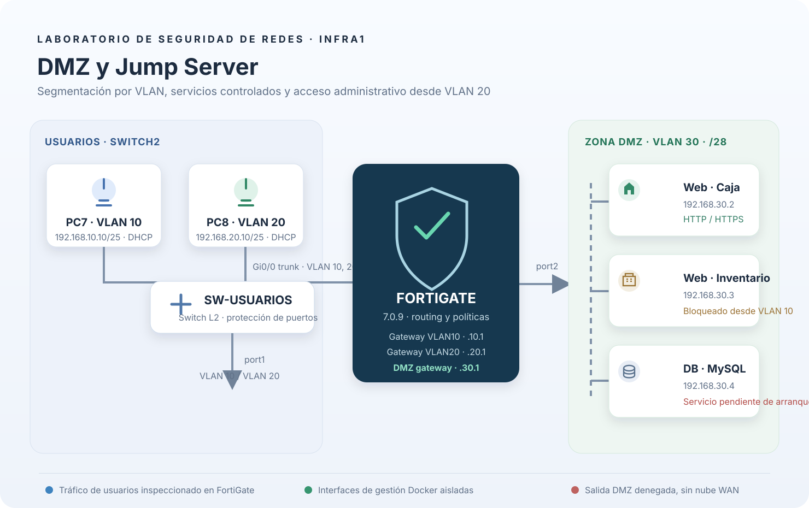

> **Vídeo demostrativo:** [ver/descargar la demostración](evidencias/video-demostrativo.mp4).

# DMZ y Jump Server · INFRA1

Este laboratorio enseña cómo separar dos redes de usuarios y tres servidores, limitar sus comunicaciones con FortiGate y dejar registro de un acceso bloqueado. FortiGate aplica el enrutamiento entre VLAN y la DMZ; los switches Cisco IOSv2 proporcionan capa 2 y seguridad de puerto.

## Topología e IPs

| Zona | Red | Gateway | Asignación |
|---|---|---|---|
| VLAN 10 · usuarios | `192.168.10.0/25` | `192.168.10.1` | DHCP; PC7 recibe `.10` |
| VLAN 20 · administración | `192.168.20.0/25` | `192.168.20.1` | DHCP; PC8 recibe `.10` |
| VLAN 30 · DMZ | `192.168.30.0/28` | `192.168.30.1` | Caja `.2`, Inventario `.3`, DB `.4` |

El troncal Gi0/0 de SW-USUARIOS lleva VLAN 10 y 20 hasta FortiGate port1. FortiGate port2 lleva tráfico sin etiqueta a SW-DMZ Gi0/0, y SW-DMZ asigna VLAN 30 a los tres servidores. El dibujo incluye las conexiones verificadas en PNETLab.

Para la topología y su propósito, consulta [el diseño de red](docs/diseno-red.md). El inventario de equipos está en [estado.md](docs/estado.md).

## Políticas configuradas

| Origen | Destino | Resultado |
|---|---|---|
| VLAN 10 | Caja, TCP 80/443 | Permitir |
| VLAN 10 | Inventario | Denegar y registrar, regla 10 |
| VLAN 10 | Resto de DMZ | Denegar y registrar |
| VLAN 20 | Caja, Inventario y DB, TCP 22 | Permitir SSH |
| VLAN 20 | Caja e Inventario, TCP 80/443 | Permitir |
| DMZ | Cualquier otra red | Denegar y registrar |

SW-USUARIOS activa PortFast, BPDU Guard y Port Security en acceso; los puertos libres están apagados y en VLAN 999. VLAN 10 no tiene administración del FortiGate. VLAN 20 puede abrir la GUI en `http://192.168.20.1` desde PC8.

## Demostración del bloqueo

1. En el escritorio remoto de PC7, abre `http://192.168.30.2`: debe mostrar Caja.
2. Abre `http://192.168.30.3`: FortiGate deniega el acceso. El navegador mostrará que no puede cargar la página.
3. En FortiGate, abre **Log & Report → Forward Traffic**. Filtra por origen `192.168.10.10`, destino `192.168.30.3` y acción `deny`; la regla `VLAN10-BLOQUEA-INVENTARIO` debe aparecer.
4. Desde PC8 en VLAN 20, ambas páginas deben responder. Solo VLAN 20 puede abrir SSH a los servidores.

La evidencia de tráfico de esta ejecución está en [log-denegacion-inventario-20261006.txt](evidencias/log-denegacion-inventario-20261006.txt); las pruebas de acceso están en [validacion-politicas-20261006.txt](evidencias/validacion-politicas-20261006.txt) y [validacion-redes-20261006.txt](evidencias/validacion-redes-20261006.txt). Los running-config están en [switch-running-configs-20261006.txt](evidencias/switch-running-configs-20261006.txt) y [running-configs-20261006.txt](evidencias/running-configs-20261006.txt).

## Acceso a PC8 por el túnel

Ejecuta el túnel guardado en [`scripts/tunel-pc8.cjs`](scripts/tunel-pc8.cjs) desde Windows. Abre [`PC8.rdp`](PC8.rdp) con `mstsc` para conectar a `127.0.0.1:13389`. El equipo debe poder conectar al host PNETLab `192.168.22.132` por SSH. **No guardes las contraseñas de PNETLab ni del FortiGate en este repositorio.**

## Archivos

- `configs/`: configuración de FortiGate y de los switches; archivos HTML de Caja e Inventario.
- `scripts/`: despliegue, configuración de los clientes y comprobaciones de este laboratorio.
- `evidencias/`: diagrama SVG y salidas de validación sin credenciales.
- `docs/`: propósito, mapa de red, decisiones y pendientes.

Los scripts de red se ejecutan desde PNETLab, y `ejecutar-fase.cjs` lleva al host solo el archivo seleccionado. `PNET_AUDIT_PASSWORD`, `FGT_PASSWORD` y el módulo `ssh2` se proporcionan por el entorno local.

## Estado y limitaciones

- VLAN, DHCP, DMZ y filtrado entre ambas redes están aplicados y comprobados.
- MySQL 8.0.23 está activo en `192.168.30.4:3306`. La base `infra1_demo` contiene la tabla `productos` y una fila de demostración; los dos servidores web alcanzan el puerto y PC7/PC8 quedan bloqueados por las políticas del FortiGate. MySQL X está limitado a loopback. La configuración está en [`configs/mysqld.cnf`](configs/mysqld.cnf); evidencia y consulta reproducible: [validacion-mysql-20261006.txt](evidencias/validacion-mysql-20261006.txt) y [`scripts/validar-mysql-infra1.sh`](scripts/validar-mysql-infra1.sh).
- El perfil AppArmor `/usr/sbin/mysqld` del host bloquea la resolución de bibliotecas AUFS y AppArmor 2.12 no ofrece aquí el aislamiento de rutas desconectadas necesario para una excepción segura. Se restauró el perfil original. MySQL corre como `/usr/local/sbin/mysqld-infra1`, heredando `unconfined` del contenedor `docker29`; por tanto, conserva el aislamiento de red del contenedor/FortiGate, pero no el perfil AppArmor individual de mysqld. El arranque y la configuración están en [`scripts/configurar-mysql-infra1.sh`](scripts/configurar-mysql-infra1.sh). El usuario administrador solo se probó por socket local; todavía no se creó una cuenta remota para aplicaciones.
- El laboratorio no tiene nube WAN. La política impide que la DMZ salga; por tanto, no se puede probar descarga de actualizaciones. No se habilitaron endpoints hasta definir la salida de Internet.
- La base de datos, IPs, reglas de contenedor y páginas de esta sesión están en ejecución; su persistencia y arranque automático tras reiniciar los contenedores están pendientes.
- El vídeo demostrativo está en `evidencias/video-demostrativo.mp4`. Falta añadir capturas de la GUI. El repositorio local tiene commits; falta configurar el remoto y publicar en GitHub.

### Acceso a PC7 desde VLAN 10

Abre [PC7.rdp](PC7.rdp) en Windows para conectar a 127.0.0.1:13390. Desde ese escritorio puedes mostrar el bloqueo de Inventario. La contraseña local del PC7 es admin. PC8 sigue disponible en [PC8.rdp](PC8.rdp), puerto 13389, con acceso a la GUI de FortiGate.

Evidencia de ambos túneles: [acceso-rdp-20261006.txt](evidencias/acceso-rdp-20261006.txt).
