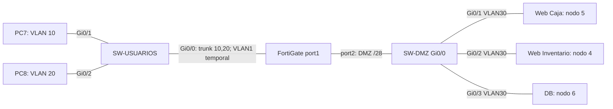

# Segmentacion de INFRA1

## Proposito

Separar usuarios y servidores mediante VLAN y una DMZ, para controlar en
FortiGate el acceso a Caja, Inventario, base de datos y administracion SSH.
Esta fase prepara las redes. Las politicas de aplicaciones y la validacion
de servicios se documentaran despues de su implementacion.

| Segmento | Red | Gateway | DHCP |
|---|---|---|---|
| VLAN10 | 192.168.10.0/25 | 192.168.10.1 | .10 a .126 |
| VLAN20 | 192.168.20.0/25 | 192.168.20.1 | .10 a .126 |
| DMZ VLAN30 | 192.168.30.0/28 | 192.168.30.1 | Caja .2, Inventario .3, DB .4, estaticas |

Las VLAN10 y VLAN20 viajan etiquetadas sobre port1. Port2 transporta la DMZ
sin etiqueta: el switch asigna VLAN30 a sus cuatro puertos conectados.
Los switches funcionan en capa 2; FortiGate es el gateway de cada red.

En los puertos de PCs y servidores se aplican PortFast, BPDU Guard y
port-security (una MAC sticky, violacion restrict). Se deshabilitan los
puertos libres y el acceso VTY remoto. No se habilita enrutamiento entre
VLAN en los switches.

El acceso 192.168.99.1 es temporal. La GUI definitiva de esta fase se
encuentra en 192.168.20.1 desde PC8. La interfaz Docker eth0 mantiene el
escritorio RDP; se revisara su aislamiento antes de las pruebas de seguridad.

Sin salida externa, el DNS publico y las actualizaciones de Internet no
pueden validarse. Entregar servidores DNS mediante DHCP no proporciona
por si solo conectividad a ellos.

Referencia: [DHCP FortiOS 7.0.9](https://docs.fortinet.com/document/fortigate/7.0.9/cli-reference/57620/config-system-dhcp-server).
