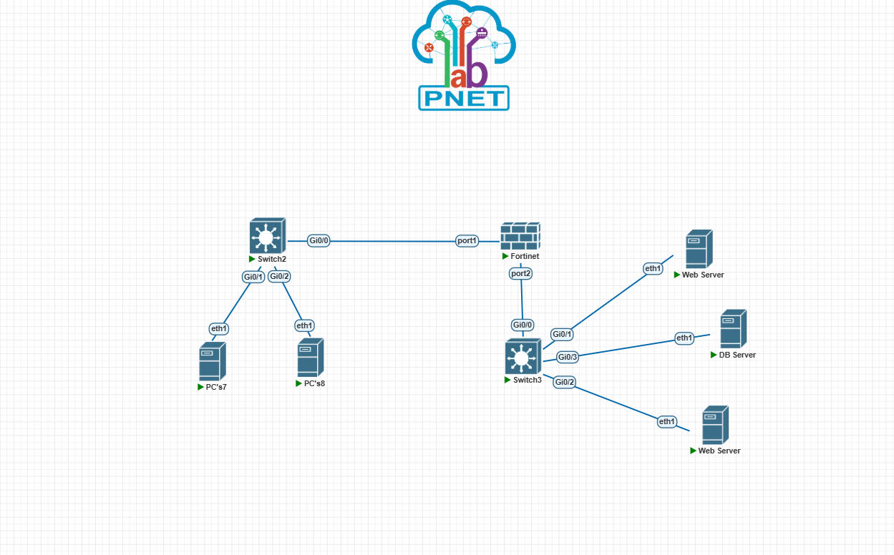
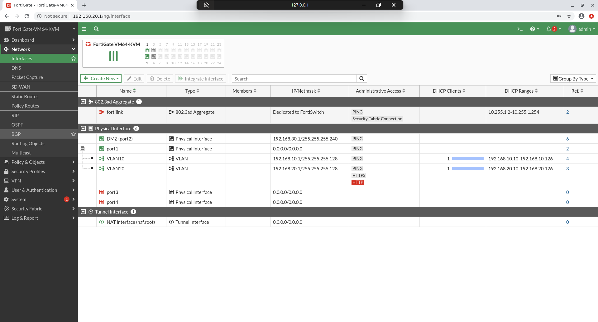
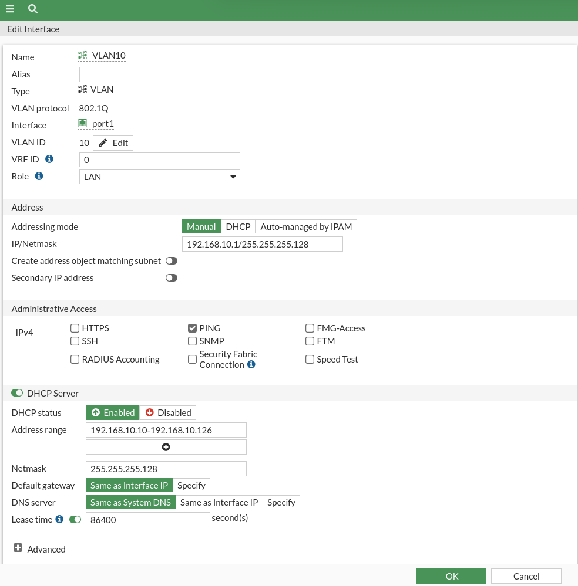
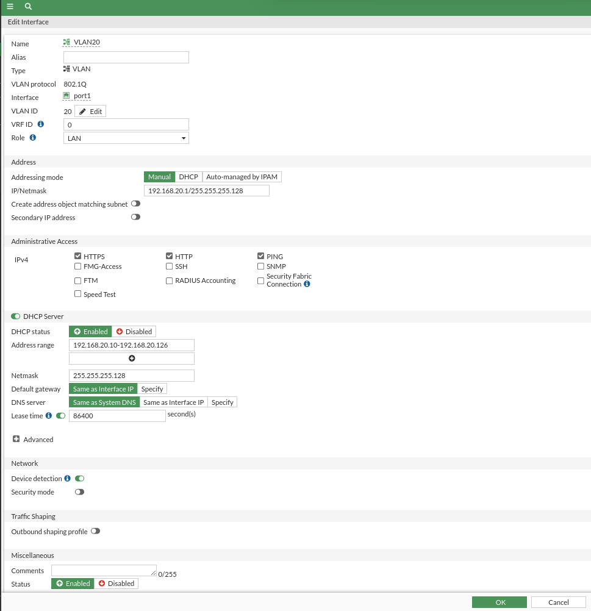
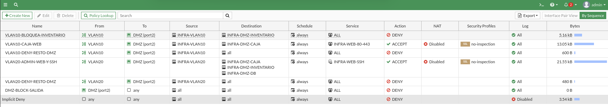
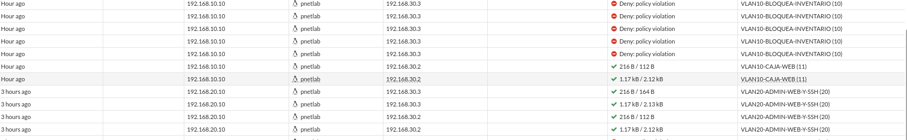

# Evidencias de esta ejecución

`topologia-infra1.svg` representa el cableado comprobado desde el archivo del laboratorio PNETLab. Los ficheros `validacion-*.txt` guardan concesiones DHCP, respuestas y pruebas de acceso. `log-denegacion-inventario-20261006.txt` contiene las entradas de tráfico de FortiGate que muestran la regla 10 denegando HTTP hacia Inventario desde VLAN 10. `switch-running-configs-20261006.txt` incluye los running-config de los dos switches con la línea de credencial ocultada. `running-configs-20261006.txt` incluye las interfaces, DHCP, objetos y políticas del FortiGate; al extraerlo de una sesión que pagina la salida, algunas secciones deben contrastarse con la CLI.

`validacion-mysql-20261006.txt` registra una consulta SQL a `infra1_demo.productos`, la escucha TCP 3306, el acceso desde los dos servidores web de la DMZ y los intentos bloqueados desde PC7 y PC8.

[`../configs/mysqld.cnf`](../configs/mysqld.cnf) es la configuración activa capturada del DB. Expone el protocolo clásico en 3306 y limita el puerto auxiliar MySQL X 33060 a loopback.

## Capturas de la GUI y topología

Las imágenes siguientes documentan la topología en PNETLab, las interfaces, el DHCP y las políticas/logs en FortiGate. El video demostrativo está enlazado al inicio del [README](../README.md).

### Topología

### Interfaces y DHCP

### Políticas y registro de denegación

